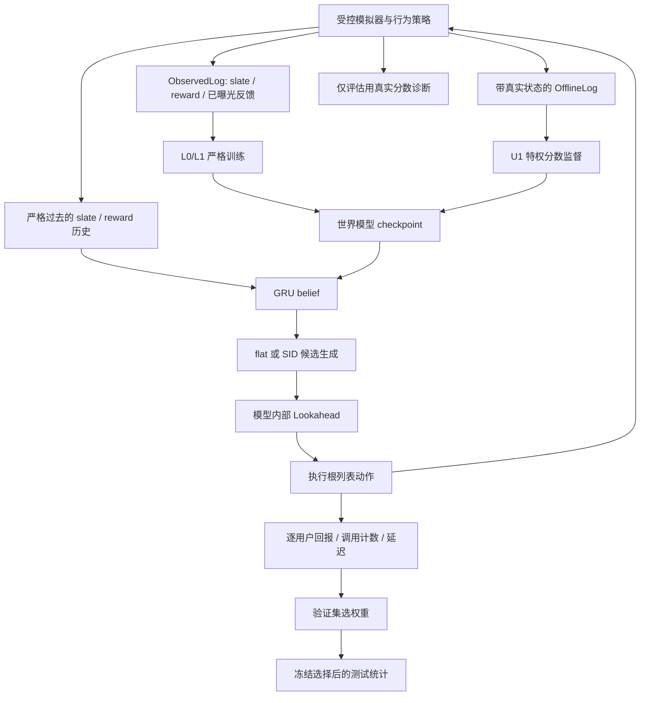

# MuSlate 代码逻辑与实现审计

审计日期：2026-10-08。对象：`D:/Coding/next_codex` 当前工作区，以及本地归档的 27 个 E1 模型与结果。审计方式：源码阅读、独立只读复核、完整现有测试、边界反例、归档一致性检查。本文记录审计发现与修复建议；本轮没有修改研究实现，也没有启动新的正式实验。

## 1. 审计结论

**当前代码已经形成“日志 → 世界模型 → 候选生成 → 模型内规划 → 真实模拟器闭环 → 验证选择与配对统计”的完整链路，但还不能把现有 E1 层次搜索结果直接作为论文最终主表。**

最重要的问题是 SID 细化可能生成含重复 item 的列表，而环境会接受并执行它。这与 flat 方法的无重复约束不同，直接影响结构对照的解释。其次，规划器没有接收剩余 episode 长度，末端仍优化 episode 结束后的虚构奖励。这两项需要修复并重跑闭环评估。

训练方面，当前 E1 的 L0/L1 信息边界成立：严格训练接口没有 simulator/state 参数，使用不含真实状态的 `ObservedLog`；已曝光反馈只监督实际展示的 item，未曝光 item 不补零。U1 的全 item 真值分数监督明确属于特权参考。**旧 B2 即使关闭 `oracle_state`，仍使用全 item 真值分数，不能称为无特权监督。**

本轮重新执行的 **103 项测试、13 个测试文件全部通过**。27 个归档 checkpoint 的实际配置、元数据身份、参数有限性、40 epoch 历史及结果数值一致性检查均通过。因此，发现的问题属于算法约束和测试覆盖缺口，不能由“测试全绿”或“文件完整”排除。

### 发现总表

优先级：P1 表示在使用受影响结果作为论文证据前必须处理；P2 表示重要的实现、接口或复现健壮性问题。优先级同时考虑触发条件，不能把旧模块的问题泛化为当前 E1 全部失效。

| 编号 | 发现 | 优先级 | 当前 E1 的影响 |
|---|---|---|---|
| A01 | SID refinement 破坏 item 唯一性 | P1 | 直接影响 `sid_hier` 的候选和执行动作 |
| A02 | 规划未处理有限时域末端 | P2，下一轮优先修复 | 直接影响所有 depth>0 搜索器的末端目标 |
| A03 | 独立 ensemble 的 latent 直接平均并回灌成员 | P1，条件性 | E1 单模型不触发；旧 ensemble/calibration 受影响 |
| A04 | MCTS 重访已展开末端叶时漏 bootstrap | P2 | E1 不使用 MCTS；旧 Q3 需复评 |
| A05 | scalar `reward` 与 batch 奖励不一致 | P2 | E1 经 batch 路径执行，不触发此缺陷 |
| A06 | Spearman 没有正确处理并列值/常量 | P2 | 排名诊断受影响；不改变闭环回报本身 |
| A07 | 单成员 ensemble 的 uncertainty 返回 NaN | P2，条件性 | E1 未调用 uncertainty；开启保守项时有风险 |
| A08 | ReactiveGreedy 接受 `adjust` 却不调用 | P2，条件性 | E1 未启用 penalty；旧保守对照的说明不准确 |
| A09 | error model 每轮丢弃尾 batch | P2 | E1 未训练 error model；影响旧保守模块 |
| A10 | error model 注释承诺的范围约束未实现 | P2，文档/保证缺口 | 不能据此声称 OOD 保守性；E1 未使用 |
| A11 | WorldModel 固定位置折扣 0.8 | P2，条件性 | 当前环境亦为 0.8；非默认位置实验会错配 |
| A12 | 分析器信任 `return_mean`，未与原始向量核对 | P2，健壮性 | 本轮 27 个真实结果一致，未发现选参被污染 |
| A13 | 完成/恢复检查没有验证完整结果依赖 | P2，健壮性 | 当前归档完整；损坏或缺失文件可能被跳过 |
| A14 | 旧“每决策等预算”表述与计量不符 | P2，实验定义 | 默认 512 的 slate 次数相等，但不是硬总计算预算 |

## 2. 代码地图与主要入口

| 层次 | 文件/目录 | 职责 |
|---|---|---|
| 配置 | `muslate/config.py` | catalog、环境、日志、世界模型、规划参数 |
| 真环境 | `muslate/env/catalog.py`、`simulator.py` | 构造语义目录、奖励、偏好漂移、饱和状态 |
| 日志 | `muslate/env/logger.py` | 特权日志与严格观测日志；行为策略采样 |
| 模型 | `muslate/model/world_model.py`、`train.py` | 历史编码、奖励/转移预测、不同信息条件训练 |
| 模型适配 | `neural_model.py`、`checkpoint.py` | NumPy/Torch 接口、模型加载与保存 |
| 候选/语义 | `planning/proposal.py`、`abstractions.py`、`sid_map.py` | flat/SID 候选与分组质量控制 |
| 搜索 | `planning/search.py` | Reactive、Lookahead、Shooting、MCTS、CEM |
| 保守与干预 | `conservative.py`、`controlled.py`、`perturb.py`、`model/error_model.py` | penalty、受控偏差、先验扰动、误差回归 |
| 评价 | `eval/rollout.py`、`calibration.py` | 完整轨迹、公共前缀、误差及排序诊断 |
| 当前主实验 | `scripts/run_logged_pilot.py` | E1 条件矩阵、不可覆盖产物、恢复与完整配置 |
| 统计/制图 | `scripts/analyze_logged_pilot.py`、`plot_logged_pilot.py` | 验证集选择、配对 bootstrap、结果图 |
| 历史实验 | `run_gate2.py`、`run_gate3.py`、`run_gate4.py`、`run_q3.py` 等 | 规划深度、动作结构、保守项与搜索器的 gate 实验 |

代码共有 24 个核心 Python 文件、15 个脚本入口和 13 个测试文件。审计重点覆盖核心训练、规划、评价和 E1 运行/统计路径；历史脚本用于核对配置与共用模块，不代表重新执行了所有历史实验。

图中的 simulator 真值用于产生观测、U1 参考或评价诊断；严格模型的训练和线上历史编码不能读取这些真值。

## 3. 环境与日志的实际逻辑

### 3.1 语义目录和隐状态

目录把 item 映射到 coarse/fine 两级 ID；默认 10×20=200 个 item。item 向量由粗类原型和 fine 原型混合后归一化，同类 item 因构造而相似。因此 SID 的语义结构与环境几何同源，随机分组、纯度控制和跨目录实验仍是必要的机制对照。

真实状态为 `SimState(h, sat, t, slates, rewards)`：`h` 是兴趣向量，`sat` 是粗类饱和度，`t` 是 episode 步数。训练日志默认从 64 个用户模板中采样用户，并给初始兴趣加入噪声。模型不输入用户 ID，用户差异主要通过历史交互推断。

### 3.2 奖励与转移

生产闭环使用 `step → step_batch → reward_batch`。令位置权重 `w_j=pos_discount^j`，粗类为 `c(i)`，长期强度为 `lt`：

\[
u(s,i)=z_i^\top h-lt\cdot sat\_penalty\cdot sat_{c(i)},
\]

\[
r(s,A)=\sum_j w_j u(s,i_j)
-div\_penalty\sum_{j<k}w_jw_k z_{i_j}^\top z_{i_k}.
\]

真实转移衰减旧饱和度并累加本次位置加权曝光；兴趣向量向列表的加权平均向量移动，再归一化。`lt` 同时缩放饱和惩罚和偏好漂移。`div_penalty` 是即时组合项，与未来状态影响不是同一个机制。

`item_scores` 只计算 unary 分数，忽略列表 pairwise 组成。因此 `ReactiveGreedy` 的 top-K 是逐项先验基线；在 `div_penalty>0` 时，它不是最优即时列表策略。代码中部分旧说明“lt=0 时 greedy 最优”需要同时限定即时目标可分解。

### 3.3 两种日志与监督条件

| 条件 | 接口 | 状态监督 | 辅助标签 | 论文可用表述 |
|---|---|---|---|---|
| L0 | `train_logged_world_model(ObservedLog, ...)` | 关闭 | 无逐项辅助项；仍有单步/多步 reward loss | 严格观测日志的 reward-only 基线 |
| L1 | 同上 | 关闭 | 已曝光 item 的连续响应 | 已曝光逐项反馈辅助训练 |
| U1 | `train_world_model(sim, OfflineLog, ...)` | 关闭 | 所有 item 的模拟器真实 unary 分数 | 特权参考模型 |
| 旧 gate/B2 | 旧接口，依具体配置 | 可开/关 | 默认 `oracle_full` | 必须逐配置披露特权信息 |

`ObservedLog` 没有 `states` 字段；严格接口拒绝 `oracle_state=True` 和 `score_supervision='oracle_full'`。当前 E1 L0/L1 从生成阶段就不构造特权状态日志。U1 保留旧接口，但通过 manifest 标明信息条件。

合成 L1 的响应为“展示 item 的 unary 真值 + 独立噪声，标准差 0.02”。产生观测时使用模拟器真值是受控模拟数据的定义；模型只收到实际展示位置的标签。额外反馈有独立随机流，不改变同 seed 的 slate/reward 轨迹。**这种连续响应不等价于真实 click，也不包括人为拆分的 pairwise 列表奖励。**

严格日志训练要求完整、定长、有序 episode。真实数据的变长历史、缺失曝光列表和会话定义尚未接入；不能直接把 KuaiRand CSV 重排为固定 K=5 就声称已经获得真实列表日志。

## 4. 世界模型与训练逻辑

### 4.1 表示和预测

`SlateEncoder` 对 item embedding 加位置权重和位置 embedding，再求和、线性映射和 tanh。默认位置权重非均匀，因此列表交换位置会影响表示；不过位置 embedding 被求和后成为常量，其本身不提供额外排序信息。

GRU 消费过去的 `(slate embedding, observed reward)`。`rollout` 先保存当前 belief，再消费当前反馈，所以 `states[:,t]` 用于预测 `r_t` 时只含 `τ<t` 的信息。空历史使用可学习 `h0`。当前 L1 的 item feedback 仅作训练辅助目标，没有作为 GRU 的新增输入。

奖励头包含：

- unary：`<g(b), e_i> + q(b)[i]`，同时服务 `item_scores` 和列表奖励；
- pairwise：可学习对称矩阵作用于 item 对，乘位置权重后求和；它允许拟合环境的组合惩罚；
- dynamics：`b_next = b + MLP(b, slate_embedding)`，供模型内 rollout 使用。

每次真实交互后，belief 从已经观察到的完整历史重新编码。搜索内部预测出的 latent 不会直接替换真实观测历史。

### 4.2 损失与掩码

总损失为单步奖励 MSE、多步奖励 MSE、可选状态辅助 MSE 和加权分数辅助 MSE。多步项沿日志中的未来动作通过预测 dynamics 推进，再预测对应奖励；它监督未来奖励准确性，没有直接要求预测 latent 等于下一步 GRU posterior。

L1 只在已曝光且有限的反馈值上计算误差。先用安全值替代 NaN，再作减法；已曝光的 0 是有效标签，全缺测时返回可微的 0。未曝光 item 不进入这项损失。主世界模型循环使用 `range(0,n_ep,batch_size)`，每轮保留尾 batch。

当前模型的 `q_head` 输出整个 catalog 的 dense 向量，即使只评估少量 item 也会计算全量输出。200 item 原型足够运行，但不能据此承诺百万 item 可扩展性；真实数据阶段需要 item 特征/因子化或按候选取分的设计，以及规模敏感性实验。

## 5. 候选生成、搜索与闭环评价

### 5.1 五种 E1 planner

| 方法 | 候选/执行逻辑 | 解释边界 |
|---|---|---|
| reactive | 模型 unary top-K 直接执行 | 无多步搜索，不优化 pairwise 组合 |
| flat_uniform | 无放回均匀采样完整列表 | 一个明确的随机候选对照 |
| flat_policy | unary 贪心 anchor + 单位置随机替换 | 局部候选池，不代表所有 flat 搜索器 |
| sid_flat | 按组内最高 item 分数生成粗类计划，再无重复补全 | 有结构但没有逐位置细化 |
| sid_hier | 在 sid 候选上按即时模型 reward 保留 widen，再在固定粗类内细化 | 当前存在 A01，需修复 |

Lookahead 每个节点评估全部候选的即时 reward，保留 beam=3，只有这三个分支递归。它是即时奖励剪枝的 beam 近似，可能错过即时收益低但未来收益高的动作，不是穷举规划。

**代码中的 `depth=0` 已包含当前奖励；`depth=2` 包含当前加未来两步，共三步奖励。** 这是现有定义，不另认定为 off-by-one；论文必须把这个约定写清楚。

### 5.2 公共前缀与信息隔离

完整 episode 从同一用户初始状态出发，各 planner 拥有自己的后续历史。公共前缀协议先由固定行为策略执行 5 步，再克隆状态、slate 历史和 reward 历史；方法从相同信息起点继续。learned latent 函数虽有 `state` 形参，实际忽略真值，只读取历史。

公共前缀后的折扣使用 `gamma**state.t`，保持 episode 原始时间尺度；完整回报等于前缀回报加后缀回报。评价真实 reward 关闭观测噪声，训练日志有噪声，这是当前协议的显式分布设定。

真实 unary 分数仅在 evaluator 的诊断回调中用于计算排序相关，不进入 L0/L1 模型更新或 planner 选择。诊断和历史编码不计入 planner latency。GPU 计时采用独立 planner 预热及前后同步，因此延迟定义是“已得到 belief 后的规划时间”，不是端到端推荐时间。

### 5.3 实际预算

`CountingModel` 把 `reward` 和 `step` 的每个具体 slate 都各计一次；`step` 同时计算 reward 和 dynamics，因此两类计数单位的实际计算量并不相同。

本轮另加只读细分计数，默认 B512/depth2/beam3 的一个决策得到：

| 方法 | 仅 reward 的 slate 数 | reward+transition 的 slate 数 | 合计 slate 次数 | item-score 状态查询 |
|---|---:|---:|---:|---:|
| reactive | 0 | 0 | 0 | 1 |
| flat_uniform | 0 | 6656 | 6656 | 13 |
| flat_policy | 0 | 6656 | 6656 | 13 |
| sid_flat | 3328 | 3328 | 6656 | 13 |
| sid_hier | 4888 | 1768 | 6656 | 13 |

四种搜索的 slate 总次数在当前默认设置下相同；但 transition 工作量不同，也没有硬总 FLOPs/墙钟限制。B512 是每节点名义分配；深度 2、beam 3 共 `1+3+9=13` 个被评估节点，所以每决策为 6656，而非 512。

通用参数也不总等量：名义 32 时 flat/sid_flat 为 416、hier 为 468；1024 时 flat/sid_flat 为 13312、hier 为 12012。小预算的最低候选数与每组可用 item 数都会影响实际开销。E1 manifest 已将它限定为 nominal budget；旧 Gate3 的通用“每决策等预算”说明应更新。

## 6. 实验编排与统计逻辑

当前冻结协议：固定 catalog 200、K=5、horizon20、gamma0.95、lt3、div0.8；latent64、pairwise、3000 训练 episode、40 epoch、batch512、Adam lr0.003、多步训练深度3。每模型 validation/test 行为日志各128 episode，每重复16个闭环评估用户。

pilot 使用 seeds1/2/3：L0 权重0，L1/U1 权重1/10/100，共21个模型。以验证集公共前缀 `sid_hier` 平均回报为唯一选参依据，各条件选择一个跨 seed 全局权重，完全并列选较小权重；再增加选定条件 seeds4/5 的6个模型，共27个。旧选择得到 L1/U1 均为100，但 A01 影响该验证选择路径，所以修复后的正式表不能机械沿用旧选择。

`run_logged_pilot.py` 的 manifest 包含实际完整配置和核心源文件 SHA256；checkpoint 保存实际 model config、state_dict、训练历史与身份。完成模型与 split JSON 以临时文件、fsync、hard link 发布，拒绝覆盖。运行锁由操作系统持有，进程退出后释放，锁文件留下也可恢复。恢复粒度是完整 checkpoint/split，**不是** optimizer/半个 epoch 的断点恢复。

分析器核查所有候选的 source/full contract、条件标签和配对案例，再选择模型并从测试逐用户向量生成差值。bootstrap 首先重抽训练/log seed，再在抽到的 seed 内重抽配对用户，10000次、分析 seed20261008、95% percentile 区间。主要独立重复单位是模型/log seed，不是把所有用户当成独立训练重复。

所有用户模板和 catalog 固定，变化的是日志、初始化、搜索与轨迹随机流。研究泛化范围是固定目录/用户群的新轨迹。逐比较区间没有多重比较校正；5 seed 的小效应需要更强确认，不能通过反复加 seed 到显著来决定停止。U1 是特权训练参考，不是数学上的最优策略上界；含0差值区间也不证明等效。

分析/制图脚本不在 runner 的核心 source fingerprint 中，最终源快照另保存了它们。以后应把 analysis version 和输入结果 hash 纳入报告 provenance，便于锁定论文表图的生成过程。

## 7. 已确认问题：证据、影响与修复建议

### A01：SID 细化允许重复 item

位置：[abstractions.py:164](/D:/Coding/next_codex/muslate/planning/abstractions.py:164)。初始 `_complete` 有去重逻辑，细化却直接执行 `cand[pos]=it`，没有排除其他位置已有的 item。环境和严格训练输入也没有统一的列表唯一性检查。

无需 checkpoint 的默认 oracle 候选复现：`n_sampled=136/out_size=136/widen4/refine_positions5/fine_per_pos12/seed0` 生成136个候选，其中6个重复，示例 `[148,91,3,3,41]`。

本轮主代理与独立复核分别只读载入归档 `L1_s1_w100`：test user0、公共前缀5步、prefix seed1003000、planner seed60001、B512/depth2。15个后续动作中6个重复，包括 t6 的 `[42,196,87,42,65]` 和 t19 的 `[68,162,24,68,159]`。完整15步动作见 [复现记录](audit_evidence_20261008/e1_duplicate_actions.json)。

这是**当前 checkpoint 的 CPU 重放**，不是原 CUDA 实验保存的动作日志；原结果只存回报和诊断，没有存逐步动作。6/15 只说明这一个案例触发，不是所有27模型的重复率估计。它与 oracle 最小反例共同确认实现可以生成并执行非法动作，不能据此推算全部回报被高估多少。

建议：细化时屏蔽其他位置已有 item；候选与最终动作均验证唯一性；对小分组容量不足明确处理。环境作为最后防线拒绝非法动作，训练输入同样核查列表约束。不能在执行后简单去重/补位并复用原预测价值，应在合法候选上完成搜索。

### A02：末端规划目标不符合有限20步回报

位置：[search.py:90](/D:/Coding/next_codex/muslate/planning/search.py:90)、[rollout.py:140](/D:/Coding/next_codex/muslate/eval/rollout.py:140)。`plan(latent)` 没有剩余步数；t18 还估计 t20，t19 还估计 t20/t21，但实际回报终止于t19。

最小二动作反例：最后只剩1步，动作0即时reward1，动作1即时reward0但会进入虚构未来reward10的状态。depth2 选择动作1，实际只收到0；有限时域最优动作0收到1。见边界证据 JSON。

建议：用公开的剩余 episode 长度限制 `effective_depth=min(depth,remaining_steps-1)`，末端 continuation 置0；若研究有意采用继续任务启发式，需要单列定义和敏感性实验。目前没有量化此修复会改变 E1 各方法排名多少。

### A03：ensemble 的 latent 坐标未对齐

位置：[neural_model.py:39](/D:/Coding/next_codex/muslate/model/neural_model.py:39)、[neural_model.py:69](/D:/Coding/next_codex/muslate/model/neural_model.py:69)。独立模型的历史 belief 先平均，再把同一均值输入每个成员的 reward、dynamics 和 uncertainty。相同 latent 维数不保证相同坐标含义；可学习 state decoder 也不强制 latent 本身对齐。

本轮用实际 `WorldModel` 构造两成员的极小反例：各自 h0 为 +1/-1，相应 reward head 的符号也改变。两个成员在自身合法状态上都预测1，adapter 却在平均latent0上预测0。这证明不是合法的预测 ensemble。

建议：保留每成员的 belief/rollout 状态，只平均共同可观测的 reward/item scores。latent uncertainty 要么先对齐，要么改为比较可观测输出。旧 ensemble 低相关结果混入坐标错配，不能直接解释为 disagreement 方法本质无效。当前 E1 n_ensemble=1 不触发。

### A04：MCTS 末端叶重访丢失 bootstrap

位置：[search.py:336](/D:/Coding/next_codex/muslate/planning/search.py:336)。`leaf_value` 每次初始化0，只有叶尚未展开时才赋最佳即时 reward；已展开的最大深度叶再次访问会回传0。

单动作反例、gamma1、max_depth1：root reward1、leaf reward2。第一次模拟 `N=1,W=3`；第二次得到 `N=2,W=4`，一致 bootstrap 应为 `W=6`。

建议缓存或每次读取已展开末端叶的 bootstrap value，测试同一叶至少两次访问。E1 不使用 MCTS；旧 Q3 的 MCTS 对照需要修复后重评。

### A05：scalar 与 batch reward 不是同一函数

位置：[simulator.py:98](/D:/Coding/next_codex/muslate/env/simulator.py:98) 对照 `reward_batch`。scalar `reward` 遗漏 diversity 项。相同状态和 `[0,1,2,3,4]`、div0.8，scalar为2.6942277899、batch为-0.1606809383，差2.8549087282恰为遗漏惩罚。

建议 scalar 委托 batch 的无噪声核心再添加噪声。E1 的 `step` 走 batch，不能把此缺陷解读为本轮漏算 diversity。

### A06：Spearman 并列排名错误

位置：[calibration.py:33](/D:/Coding/next_codex/muslate/eval/calibration.py:33)。两次 argsort 赋唯一序号，不使用平均并列 rank。常量 `[1,1,1]` 对 `[1,2,3]` 返回1；`[1,1,2]` 对 `[1,2,3]` 返回1，平均并列 rank 的相关应为0.8660254。

建议采用标准平均并列 rank，明确常量/全缺测的处理约定。旧 seed1 的每条件2560个 test logged 状态审计显示并列仅2–5行，平均调整绝对值不超过约7.05e-8，未改变其四位小数报告；此影响估计只覆盖该先前保存的子样本，不推广到全部诊断。未来二元标签、离散/常量 prior 会更容易触发。闭环回报不依赖该诊断函数。

### A07–A08：保守接口边界不完整

单成员 uncertainty：[neural_model.py:91](/D:/Coding/next_codex/muslate/model/neural_model.py:91)，`torch.std` 默认样本校正使单成员返回NaN；`latent_uncertainty` 同理。建议明确拒绝不足2成员的 disagreement，或返回0并记录“无 ensemble 信号”。不能让NaN进入 penalty 或 argmax。

Reactive penalty：[search.py:59](/D:/Coding/next_codex/muslate/planning/search.py:59)。传入有副作用的 `adjust` 后执行 `ReactiveGreedy.plan`，调用次数仍为0；当前测试只验证 hook 被保存和 sid_hier 触发。建议明确它是不加 penalty 的参照，或另实现按调整后列表价值选动作的 conservative reactive。E1 adjust=None，两项均未进入当前主评估。

### A09–A10：error model 训练与保证

位置：[error_model.py:138](/D:/Coding/next_codex/muslate/model/error_model.py:138)。`n_batches=n//batch_size`，n不整除时尾 batch 每轮被舍弃。动态记录 `forward`，6条样本/batch4/epoch1实际只处理4条。每轮随机打乱意味着不是永远固定丢同一组，但每轮预算和覆盖仍不完整。建议使用按起点遍历并包含尾 batch。

文件顶部说明声称输出受“observed error envelope”范围约束；实际只有 softplus 非负输出和 log-error MSE，既没有上界，也没有 OOD 置信度下界。将末层bias设1000时，输出1000；softplus也能趋近0。建议删除未实现的保证，或显式设计与验证相应约束。即使简单裁剪到训练误差上界，也不能自动保证分布外保守性。

当前 E1 未调用 error model，这两项影响后续保守实验和旧 gate。

### A11：环境位置折扣未传入模型

位置：[world_model.py:81](/D:/Coding/next_codex/muslate/model/world_model.py:81)。WorldModel 调用 SlateEncoder 默认0.8；模型配置没有对应参数。环境折扣0.5时位置权重为 `[1,.5,.25,.125,.0625]`，模型仍为 `[1,.8,.64,.512,.4096]`，unary 与 pairwise 位置权重均错配。

建议从明确的日志/任务 metadata 获取位置权重，记录在模型配置和 checkpoint；非默认位置实验加入配对结构验证。当前 E1 两侧均0.8。

### A12–A13：结果校验与恢复健壮性

分析器：[analyze_logged_pilot.py:85](/D:/Coding/next_codex/scripts/analyze_logged_pilot.py:85)。验证了 returns 向量的长度和有限性，却未核对 `return_mean==mean(returns)`；选参直接用缓存的 `return_mean`。构造合法向量 `[1,2]` 并将权重1的 mean 改成1e100，仍通过验证并选中权重1。

建议从原始向量计算选参指标，核对所有缓存汇总、prefix+tail、决策数和必需 planner/protocol schema。**本轮另行核查的27个真实结果均一致，所以没有证据显示当前选择是被汇总值损坏造成的。**

恢复：[run_logged_pilot.py:66](/D:/Coding/next_codex/scripts/run_logged_pilot.py:66)、[run_logged_pilot.py:240](/D:/Coding/next_codex/scripts/run_logged_pilot.py:240)。一个只有匹配identity和`status=complete`的 result，即使没有checkpoint和split文件，也会被 `claim_run` 标为complete并跳过；split恢复主要检查identity。

建议复用前校验完整 schema、checkpoint、必要 split 及文件hash；损坏产物明确失败或进入新修复目录。当前归档已经独立全量校验，不受这条反例的实际文件缺失影响。

### A14：计量承诺需与实现一致

位置：[run_gate3.py:53](/D:/Coding/next_codex/scripts/run_gate3.py:53)、`CountingModel`。第5.3节已给实测：当前默认配置 slate 次数相等，但混合 reward-only 与 reward+transition，并且不是每决策512次硬预算。

建议记录两类调用、score查询、提案成本、显存和端到端延迟；采用硬预算协议后重测 return–cost 曲线。在此之前只能声称“当前配置下匹配具体 slate 评估次数”，不能声称所有预算、所有搜索器或完整计算开销严格相等。

## 8. 论文证据如何处理

现有结果可以保留为实现版本 v1 的完整历史记录，不应删去或覆盖。**现有 SID-hier 与 flat/SID-flat 的差值、由 SID-hier 验证指标选出的权重及相关机制结论，需要在修复后重新确认。** 不能仅因默认调用数匹配或置信区间不含0，就把动作约束错误视为可忽略。

L1 相对 L0 的 logged 排名/奖励误差改善不经过 SID 执行动作，这类独立诊断与监督边界证据仍有参考价值；Spearman 应统一修正后重算。使用固定 SID-flat 的 L1–L0 回报比较不涉及 refinement 重复，但仍要处理共同的末端目标问题。不能把受影响程度不同的证据一概宣布有效或一概作废。

旧 Gate4 的 ensemble 相关性与旧 Q3 的 MCTS 比较需要在 A03/A04 修复后复评。历史 `oracle_state=False` 并不能排除 `oracle_full` 分数特权；论文表格必须按真实监督来源标注。

学术范围仍限于固定合成环境：真实数据目前完成下载/字段审计，没有完成真实反馈训练与闭环结果；不存在原生 request/position 的字段，构造会话/列表须单独披露。跨用户、跨目录、大目录、日志覆盖、收敛预算、OOD误差校准和机制干预也尚未由当前结果证明。

## 9. 建议的修复与重跑顺序

1. **先冻结本审计及旧结果**：保留当前source/checkpoint/selection，给修复版独立协议版本与输出目录。记录上述CPU重放范围，后续新增逐步动作、唯一性和剩余时域诊断。
2. **修复当前主路径**：A01动作约束、A02末端深度；同时处理A06排名函数与A12/A13产物校验。添加能复现问题的回归测试，覆盖SID pool、已选动作和同一末端叶重访等实际行为。
3. **重建E1正式比较**：先小规模合法性检查，再在修复版重评全部21个pilot checkpoint的validation/test，并重新执行冻结的验证选择；随后确认seeds4/5。若重新选出的辅助监督权重不是100，需要为新选择训练缺少的确认模型。仅规划/诊断修复、训练源码和配置不变时可复用经校验的原模型 checkpoint 参数，但必须记录旧checkpoint来源与新评估源码，不能伪称全新模型。
4. **并行准备下一阶段设计，但不混入主表**：收敛控制与L0/L1/U1匹配训练预算；冻结reward/dynamics只干预prior；随机等大小分组、纯度与细化消融；分开统计 reward/transition 的硬计算预算。
5. **启用旧分支前修复其缺陷**：A03 ensemble 状态、A04 MCTS、A05 scalar reward、A07–A11保守/参数接口；修复后重跑受影响的旧gate，而不是直接引用历史数值。
6. **真实日志阶段**：冻结时间切分、反馈link、session/list构造、候选覆盖与模拟器隔离，完成观测预测后再讨论闭环效果。当前定长200-item实现不能直接替代这一工作。

本节是审计后建议，不表示这些修复和重跑已经完成。本次交付是逻辑说明、缺陷证据和明确的处理顺序。

## 10. 核验记录与边界

本轮新核验产物均保存在 [audit_evidence_20261008](audit_evidence_20261008/)：

| 文件 | 内容 |
|---|---|
| [test_run.json](audit_evidence_20261008/test_run.json) | 13文件完整stdout/stderr、退出码、103测试计数、Python版本 |
| [artifact_integrity.json](audit_evidence_20261008/artifact_integrity.json) | 27模型实际配置/身份/参数/回报/源指纹全量核验 |
| [boundary_reproductions.json](audit_evidence_20261008/boundary_reproductions.json) | ties、常量、尾batch、范围、恢复、MCTS、ensemble等最小反例 |
| [e1_duplicate_actions.json](audit_evidence_20261008/e1_duplicate_actions.json) | 一个真实归档checkpoint的15步CPU动作重放 |
| [budget_accounting.json](audit_evidence_20261008/budget_accounting.json) | 名义32/256/512/1024的实际调用 |
| [detailed_default_budget.json](audit_evidence_20261008/detailed_default_budget.json) | 默认配置下 reward-only 与 transition 分别计数 |

27模型归档SHA256：`d8d057ceec651435a9e650cfb77793ce35ee0249981f0617cd5036693d4e3255`。本轮核对归档manifest的核心源码指纹与当前本地源码一致；检查全部checkpoint实际config与metadata身份、参数有限、state loss为0，全部returns均值、prefix+tail和决策数一致。原始完整实验累计151,200次闭环决策，**本轮没有全量重放这151,200次动作**。

本轮以当前工作区和本地归档为审计对象，没有把服务器原始目录中可能存在的并发改动视为已审阅。既有KuaiRand字段审计用于明确接入边界，没有重新扫描远程全部CSV。先前保存的rank tie子样本估计亦注明其范围。

考虑但未列为确定实现错误的行为：

- Lookahead即时beam剪枝、SID即时reward预筛：明确的近似算法，收益/失败区域需实验分析。
- pairwise矩阵初值为正：参数可学习并可表达负惩罚，不能凭初值判定无法拟合。
- posterior与预测dynamics没有latent一致性loss：当前以多步reward监督，是模型设计选择；需预测误差/消融验证其充分性。
- BehaviorSupport的item频率代理：不是列表联合行为概率，现有实现承认简化；不能作为严格OPE/support证明。
- 固定目录与用户群、连续响应、共享设备延迟：研究与协议限制，不能包装成实现bug，也不能当作已完成的外部验证。
- 修复后是否发生方法排名翻转：尚无重跑证据，不作推断。

**最终判定：工程链路可运行、严格日志训练边界可核实；当前层次搜索主结论需在动作合法性和末端目标修复后重新验证。**
